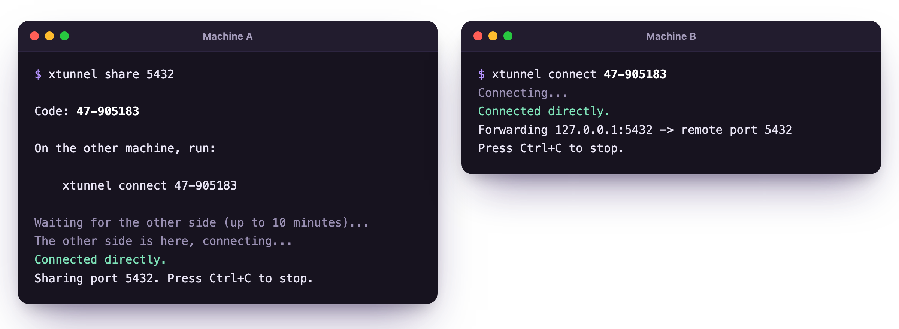

<p align="center">
  
</p>

<h1 align="center">XTunnel</h1>

<p align="center">
  Share a TCP port between two machines over an encrypted peer-to-peer tunnel.
</p>

<p align="center">
  <a href="https://xazar-mammadli.github.io/XTunnel/">Website</a> ·
  <a href="https://github.com/xazar-mammadli/XTunnel/releases/latest">Download</a>
</p>

<p align="center">
  <a href="https://github.com/xazar-mammadli/XTunnel/releases/latest"></a>
  <a href="https://github.com/xazar-mammadli/XTunnel/actions/workflows/ci.yml"></a>
  
  <a href="LICENSE"></a>
</p>

<p align="center">
  
</p>

## Features

- **One short code:** `xtunnel share` prints a code like `47-905183`, and `xtunnel connect` with that code reaches the port from anywhere.
- **Direct:** traffic goes straight between the two machines, through NATs, not through a server.
- **Encrypted end to end:** QUIC with TLS 1.3, bound to the code, so nobody in between can read or take over the tunnel.
- **Any TCP port:** databases, web apps, SSH, several ports at once.
- **Nothing to set up:** a free public relay introduces the two sides. You can also pair offline or host your own.
- **One small binary** for Linux, macOS and Windows.

## Security

- Traffic is encrypted end to end. The relay only introduces the two sides and can't read or change the tunnel.
- Codes are one-time: a wrong guess or a second use closes the room.
- The sharing side only accepts connections to the ports you list, on `127.0.0.1`.
- No accounts and no tracking.

## Install

```bash
curl -fsSL https://xazar-mammadli.github.io/XTunnel/install.sh | sh
```

Or download the archive for your system from the [latest release](https://github.com/xazar-mammadli/XTunnel/releases/latest), or run `go install github.com/xazar-mammadli/XTunnel/cmd/xtunnel@latest`.

## Usage

| Command | What it does |
| --- | --- |
| `xtunnel share 5432` | shares local port 5432 and prints a one-time code |
| `xtunnel connect 47-905183` | makes the shared port reachable at `127.0.0.1:5432` |
| `xtunnel connect 47-905183 15432:5432` | uses local port 15432 instead |
| `xtunnel share --offline 5432` | pairs by copy-paste, without any server |

Run `xtunnel help` for every option.

## Self-hosting

The public relay only introduces the two sides: two very strict NATs can't connect through it, and a dropped tunnel needs a new code. For a TURN fallback, automatic reconnect or your own infrastructure, run `xtunneld` or [your own relay on Cloudflare](relay/cloudflare/README.md), and point `--server` at it:

```bash
xtunneld --listen :443 --tls-cert cert.pem --tls-key key.pem --turn-public-ip 203.0.113.7
xtunnel share 5432 --server wss://tunnel.example.com
```

The wire protocol is described in [docs/PROTOCOL.md](docs/PROTOCOL.md).

## Build from source

```bash
git clone https://github.com/xazar-mammadli/XTunnel.git
cd XTunnel
go build ./cmd/xtunnel
```

You need Go 1.25 or later. Run the tests with `go test ./...`.

## Contributing

Issues and pull requests are welcome; see [CONTRIBUTING.md](CONTRIBUTING.md). Please report security problems privately, as [SECURITY.md](SECURITY.md) describes.

## License

[MIT](LICENSE)
